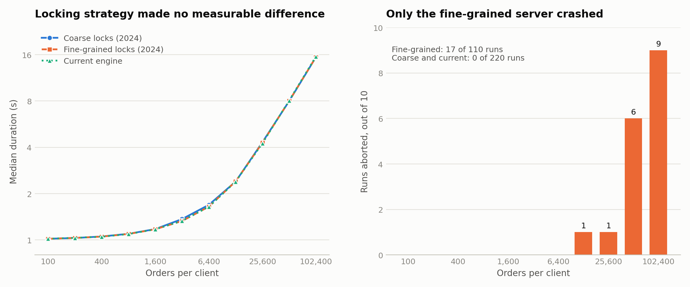

# Concurrent C++ Matching Engine

[](https://github.com/chiefmanny/order-matching-engine/actions/workflows/ci.yml)

This is a multithreaded limit order book in C++17. It does price-time priority, keeps a separate book per symbol, and has a gRPC server that streams market data to clients. I wrote the original engine by hand in 2024 while I was learning C++ concurrency and trying out a lot of the STL, and later built a market simulation on top of it.

Start with [the locking experiment](#the-locking-experiment) if you only read one part. I tried finer-grained locks, they didn't make my benchmark measurably faster, and they added a use-after-free that crashes the server under load.

There's also a [demo in the browser](https://manan-opal.vercel.app/projects/market-microstructure) that replays recorded sessions. The engine matched every order in those, and [finchart](https://github.com/chiefmanny/finchart) draws the charts.

## Who wrote what

| Work | When | How it was written |
|---|---|---|
| [Engine, gRPC server, and original tests](https://github.com/chiefmanny/order-matching-engine/tree/handwritten-2024) | 2024 | By hand, every line |
| [Fine-grained locking branch](https://github.com/chiefmanny/order-matching-engine/tree/fine-grained-2024) | 2024 | By hand |
| Engine fixes, simulated traders, experiment harness | 2026 | AI-assisted |
| Benchmark setup and this README | 2026 | AI-assisted |
| [finchart](https://github.com/chiefmanny/finchart), the Rust charting library | 2026 | AI-assisted |

`src/core` is 779 lines today, 438 from 2024 and 341 from 2026. If you only want to read what I wrote by hand, use the [`handwritten-2024`](https://github.com/chiefmanny/order-matching-engine/tree/handwritten-2024) tag.

## How the engine works

```
 clients <──gRPC──> server thread pool ──add / cancel / read──> OrderBook (one per symbol)
                            ^                                     asks: std::map<price, level>
                            │ fills                               bids: std::map<price, level>
                            │                                     level: FIFO deque of orders
                            │                                     index: order id -> order
                            │                                             ^
                     matching thread (one per symbol) ──crosses the book──┘
```

Each symbol gets its own matching thread. It wakes up on a 1 ms timer, locks both sides of the book, and crosses the best bid and ask until they stop overlapping. Orders at the same price fill FIFO.

Each side of the book has a `std::shared_mutex`, and so does each order index. The matcher takes both sides with [`std::lock`](https://github.com/chiefmanny/order-matching-engine/blob/handwritten-2024/matching_algorithm.cpp#L34), and writers use `std::scoped_lock`, which avoids deadlock from taking those locks in different orders.

`AddLimitOrder`, `CancelLimitOrder`, and `CheckSymbol` are single calls. `WatchSymbol`, `Subscribe`, and `GetLevel2` stream quotes, fills, and depth.

```
src/core/            order book + matching algorithm
src/grpc/            gRPC server and client
src/clients/         benchmarks, participant framework, trading strategies
tests/unit/          C++ tests
experiments/         scenario runner, recorder, metrics, plots, presets
backend/ frontend/   FastAPI + React demo showing live candles and Level 2
docs/benchmarks/     benchmark setup and raw results
```

## The locking experiment

The 2024 engine locks a whole side of the book for every operation, so adding an order at one price blocks an add at any other price. To get around that I built a [fine-grained version](https://github.com/chiefmanny/order-matching-engine/tree/fine-grained-2024) with [a mutex per price level](https://github.com/chiefmanny/order-matching-engine/blob/fine-grained-2024/limit_price.h#L31), so a writer only holds the tree lock long enough to find its level. `master` stayed on coarse locks.

In November 2026 I benchmarked three versions (coarse, fine-grained, and the current engine) with the same compiler, flags, and client programs:

<picture>
  <source media="(prefers-color-scheme: dark)" srcset="docs/benchmarks/results-dark.png">
  
</picture>

| Orders per client | Coarse | Fine-grained | Current | Fine-grained runs aborted |
|---:|---:|---:|---:|---:|
| 1,600 | 1.18 s | 1.17 s | 1.17 s | 0 of 10 |
| 12,800 | 2.40 s | 2.40 s | 2.39 s | 1 of 10 |
| 51,200 | 7.99 s | 8.01 s | 8.07 s | 6 of 10 |
| 102,400 | 15.44 s | 15.45 s (1 clean run) | 15.57 s | 9 of 10 |

Median latency to acknowledge one order was 96-97 µs on all three. The largest size works out to about 13,000 order submissions per second across two clients. These are gRPC round trips in a Linux VM, so they don't tell you how fast the matching itself is. The [method, caveats, and raw data](docs/benchmarks/README.md) are in the benchmark docs.

### Why it crashed

[`addLimitOrder`](https://github.com/chiefmanny/order-matching-engine/blob/fine-grained-2024/order_book.cpp#L56-L75) finds the price level, lets go of the tree lock, and only then locks the level. Simplified:

```cpp
{
    std::shared_lock<std::shared_mutex> sharedLock(askMutex);
    limitPrice = &it->second;                  // pointer into the map
}                                              // tree lock released here
                                               // <-- the matcher can erase the level here
std::lock_guard<std::mutex> lock(limitPrice->mtx);
limitPrice->orders.push_back(addOrder);        // use-after-free
```

If the matcher [empties and erases that level](https://github.com/chiefmanny/order-matching-engine/blob/fine-grained-2024/matching_algorithm.cpp#L103-L107) during that gap, the writer is using freed memory. AddressSanitizer caught this in 3 of 3 runs, and [the report](docs/benchmarks/results/asan/fine_report.txt) shows the free and the bad access in those spots, on the ask side. The bid side has the same code. Coarse and current came back clean under the same load.

I hit crashes on this branch back in 2024 and fixed several of them (see [earlier debugging](#earlier-debugging)). This one is a separate bug in the add path. It was still there in 2026, when the benchmarks and AddressSanitizer runs caught it.

The obvious fix is to hold the tree lock while taking the level lock, but that would deadlock, because the matcher holds a level lock while it waits for the exclusive tree lock. That's the opposite order. I think a correct version needs reference-counted levels and a "retired" flag that writers re-check after locking, and retry if the level is gone. I haven't built that, since the results below suggest the locks aren't where the time goes.

This bug also threw off an early benchmark run. Failed RPCs return immediately, so once the server crashed the rest of the run went by fast, and fine-grained looked almost three times faster. So the benchmark now records whether the server survived each run.

### Why it wasn't faster

Times were within about 1% at the largest size, so whatever is limiting this test, it isn't the book's locks. My best guess is the gRPC round trip, at nearly 100 µs per order, but I haven't timed the book on its own to confirm that. The test also only has two clients and one matcher, which isn't much contention, so fine-grained locking might still help with a lot more writers.

### Earlier debugging

Some other things from the 2024 commit history:

- A [bad access from `.front()` on a level's orders](https://github.com/chiefmanny/order-matching-engine/commit/b81ca70), tracked down with LLDB
- [Volume counted twice](https://github.com/chiefmanny/order-matching-engine/commit/385fbf5) on full fills
- A [cancel that erased a bid level from the ask tree](https://github.com/chiefmanny/order-matching-engine/commit/4a0826b) in the fine-grained branch
- [Cancel calling `begin()` on a tree that could be empty](https://github.com/chiefmanny/order-matching-engine/commit/fa928e0) after erasing its last level, also in the fine-grained branch
- A [test showing](https://github.com/chiefmanny/order-matching-engine/commit/7f378a3) that one client's requests run in order, while requests from different clients can interleave

For debugging I used LLDB, [AddressSanitizer](https://github.com/chiefmanny/order-matching-engine/commit/05214b2), and Valgrind. Valgrind meant moving the whole project into an Ubuntu VM.

## Bugs fixed since 2024

The hand-written engine also had bugs I didn't catch in 2024. These were found and fixed during the AI-assisted work on the market simulation in 2026. They're all in [`d17cc8b`](https://github.com/chiefmanny/order-matching-engine/commit/d17cc8b), and `book_invariant_tests` covers them now.

| Bug | Effect | Fix |
|---|---|---|
| [Trades printed at the midpoint](https://github.com/chiefmanny/order-matching-engine/blob/handwritten-2024/matching_algorithm.cpp#L61) of the two limit prices | Wrong trade prices, and slippage measurements were an artifact | Orders carry an arrival sequence, and the resting order sets the price |
| `LimitPrice::totalSize` never initialized or reduced on fills | Level 2 depth numbers were undefined and drifted | Initialized, and maintained on every fill |
| Order ids drawn from the full unsigned range, but sent as `int32` | Ids above 2^31 came back negative | Drawn from `[1, INT32_MAX]` |
| Filled orders stayed in the order index | Cancelling a filled order could succeed and corrupt depth | Filled ids are removed after each match |

The 2026 benchmarking also turned up a March 2024 bug in the stress tests. A buy ratio above 100% made an unsigned count wrap around, so the test tried to add about 4.3 billion orders and couldn't finish.

## What I'd change for low latency

This engine is built on shared state and locks, so a lot of it is slow by low-latency standards. Here's what I'd do differently if latency was the goal:

| Today | Cost | What I'd build instead |
|---|---|---|
| Matcher [sleeps 1 ms between passes](src/core/matching_algorithm.cpp#L209) | A crossing order can wait about a millisecond to match | Match on arrival, inside the order's own processing |
| Many threads share the book behind locks | Contention and unpredictable waits | One writer thread per symbol, fed by a queue |
| `std::map<double, ...>` for price levels | Pointer chasing, cache misses, and floating-point keys | Integer tick prices with array-indexed levels |
| A `shared_ptr` allocation per order | An allocator call and atomic ref-counting on the hot path | Pre-allocated pool with intrusive lists |
| gRPC on every order | Nearly 100 µs per round trip in this setup | A binary protocol, with the core measured in process |

My next project is a hand-written core along those lines, benchmarked in process with latency percentiles.

## Build and test

The core and the fast tests only need CMake and a C++17 compiler. nlohmann/json comes from your system if it's installed, otherwise CMake pulls it from GitHub at configure time.

```bash
cmake -B build && cmake --build build -j8
./build/participant_tests        # strategies, order tracking, tick math, event log
./build/book_invariant_tests     # depth bookkeeping and the trade tape
./build/order_book_tests         # multithreaded stress tests, about 15 seconds
python3 experiments/tests/test_scenario.py
python3 experiments/tests/test_metrics.py
```

The server and clients also need gRPC and protobuf. Docker is the easiest way to get those:

```bash
docker build -f Dockerfile.cpp -t ome-cpp:latest .
```

## Market simulation

Simulated traders run against the engine over gRPC, and Python just runs the experiments and analyzes the results. The harness states a hypothesis before each run and reports whether it held. This part is AI-assisted. I kept it in the repo because that's where the engine's bugs came up, and it produces the recordings in the browser demo.

### Market participants

`participant_runner` is one executable that becomes whichever participant its config
asks for. Adding a new one takes a strategy file and one line in the registry.

| strategy | what it does |
|---|---|
| `liquidity_provider` | maintains a multi-level two-sided book; replenishes, re-centers, and shifts its quotes as inventory accumulates. Supports `mode: withdraw` to pull its book mid-run |
| `noise_trader` | background order flow, both sides, partly aggressive, with cancellations |
| `market_maker` | quotes near the touch, skews on inventory, withdraws a side at its limit |
| `directional_trader` | sustained one-sided pressure over a configurable duration |
| `parent_executor` | works a large parent order: `immediate`, `sliced`, `participation`, or `passive_first` |
| `sweep` | alias for `parent_executor` in immediate mode |
| `layering_demo` | educational manipulation-detection demonstration (see below) |

Strategies only depend on a small `OrderGateway` interface, so the unit tests run them
against a fake gateway, without the engine, gRPC, or threads.

### Running an experiment

```bash
pip install -r experiments/requirements.txt
docker build -f Dockerfile.cpp -t ome-cpp:latest .

experiments/run.py experiments/scenarios/static_book.yaml
experiments/analyze.py experiments/results/static_book/run_001
```

`run.py` starts the engine, attaches a recorder, launches participants on a timeline,
shuts everything down, and checks the run. Each run gets its own directory:

```
trades.csv  bbo.csv  level2.csv  candles_*.csv
participant_events.jsonl   summary.json   metadata.json   plots/  logs/
```

A run only counts as OK if the recorder covered the right window, every participant
reported final metrics, and nobody left live orders in the book.

#### Comparing and tuning

```bash
# Vary one parameter, aggregate repeats, and flag differences inside run-to-run noise
experiments/sweep.py <scenario> --param participants.lp1.config.averageQuantity \
    --values 250,500,1000 --repeat 3

# Compare runs; the varying parameter is detected by diffing their configs
experiments/compare.py experiments/results/_sweeps/*/run_001 \
    --metrics sweep.peak_impact_ticks --curve sweep.peak_impact_ticks
```

### Presets

Presets are scenarios that are already calibrated and ready to launch. Use these for a
UI or a demo.

```bash
experiments/presets.py list
experiments/presets.py verify          # runs each one and records whether it held up
experiments/presets.py manifest        # machine-readable index for a consumer
```

`normal_market`, `thin_liquidity`, `buy_sweep`, `large_buy_sweep`, `selloff`,
`liquidity_crisis`, `volatility_shock`, `market_maker_inventory_pressure`,
`execution_immediate`, `execution_sliced`, `spoofing_detection_demo`.

`presets/manifest.json` has each preset's description, participants, and the verdict
from the last verification run, so you can see which ones currently hold up.

Scenarios under `experiments/scenarios/` are more for investigating things, like
controls, parameter ladders, and A/B arms.

### Hypotheses

Every scenario says what it expects before it runs, and the analysis marks the outcome
as consistent, partially consistent, or inconsistent. With a synthetic market it's easy
to look at the results afterward and decide that whatever happened is what you meant,
so the expectation gets written down first.

Several findings in this repository came from that check failing.

### Manipulation-detection demonstration

`spoofing_detection_demo` runs a layering actor alongside normal participants in the
simulated market. It's about detection: which behavioral measures separate a
manipulative actor from the others, and which ones are misleading.

The first anomaly score written for it ranked the liquidity provider as more anomalous
than the layering actor. The provider cancels 99.9% of its orders, because quoting
continuously means requoting continuously. That false positive is written up in
`experiments/metrics/manipulation.py`.

It only runs against this synthetic engine and simulated participants.

### Demo web app

The demo is three containers behind nginx: the engine, a FastAPI/WebSocket bridge, and
a React front end with live candles and Level 2.

```bash
docker compose up -d     # then open http://localhost
```

The chart stays empty until participants are trading. Start some with a preset, or
directly:

```bash
docker exec -it order-matching-engine-cpp-server-1 \
  ./participant_runner --config /path/to/participant.json
```

To deploy elsewhere, rebuild the front end with your own URLs:

```bash
docker compose build \
  --build-arg REACT_APP_API_HTTP_URL=https://yourdomain.com \
  --build-arg REACT_APP_API_WS_URL=wss://yourdomain.com \
  frontend
```

### Known limitations

Some things to keep in mind when reading the results:

- No participant has a view on value, so a big enough directional push moves the price
  permanently, with no limit. That follows from who's in the simulation, but it isn't
  realistic.
- Thin books are erratic. Scenarios with sparse liquidity vary a lot from run to run, so
  use `sweep.py --repeat` before believing a difference. `volatility_shock` documents its
  own spread.
- Runs aren't bit-for-bit reproducible. A fixed seed reproduces a participant's decisions,
  but engine order ids are random and thread interleaving isn't deterministic, so
  aggregate metrics are stable and tail metrics aren't.
- The engine has no immediate-or-cancel order type, so the unfilled remainder of an
  aggressive order rests inside the spread. Effective spread ends up driven by those
  remainders more than by the provider's quotes.

## License

[MIT](LICENSE)
